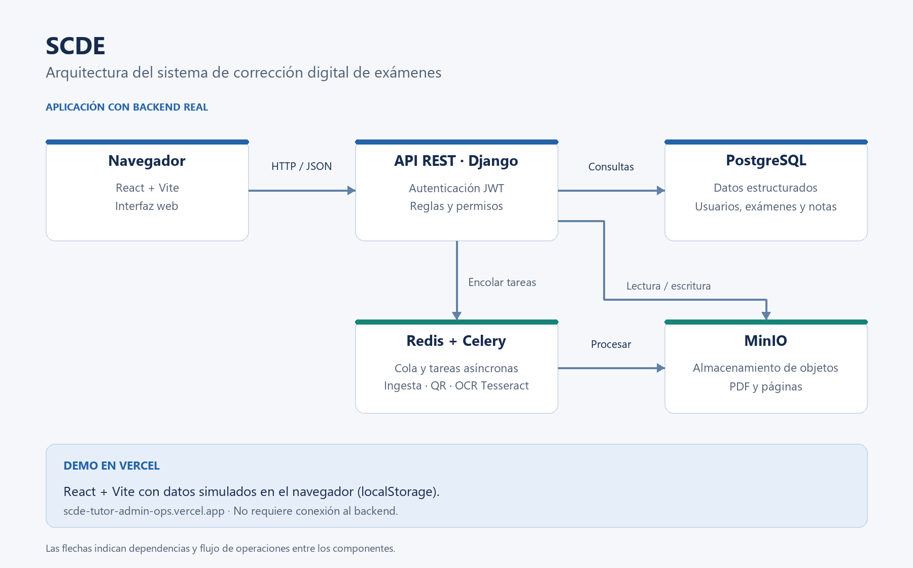

# SCDE — Sistema de Corrección Digital de Exámenes

Repositorio de entrega: https://github.com/soleer6/SCDE.

Frontend para gestionar asignaturas, exámenes, ingesta de páginas, corrección, resultados y revisiones. Incluye administración de usuarios y organizaciones, permisos, notificaciones y perfil.

## Stack

React 19, Vite 7 y JavaScript; React Router para navegación, i18next para traducciones y React PDF para documentos. ESLint revisa el código; Vitest y Testing Library ejecutan las pruebas.

## Estructura

- `src/app/`: arranque de la aplicación, navegación, registro de módulos y traducciones comunes.
- `src/features/`: módulos funcionales; cada uno reúne pantallas, llamadas a la API, traducciones y simulaciones. Incluye workspace, exámenes, ingesta, corrección, resultados, revisiones, administración y cuenta.
- `src/lib/`: cliente HTTP, autenticación JWT, permisos, utilidades y base de datos simulada.
- `src/ui/`: componentes visuales reutilizables.
- `src/styles/`: variables de diseño y estilos globales.
- `src/test/`: configuración de pruebas y comprobaciones de contrato. También hay pruebas junto a los módulos.
- `public/`: recursos estáticos.
- `docs/`: arquitectura y documentación del frontend y del contrato HTTP.
- `scripts/`: análisis del contrato y auditoría de estilos.

## Ejecutar con datos simulados

Requisitos: Node.js 22.12 o superior (también Node.js 24) y npm.
Desde la carpeta de esta entrega:

```powershell
npm ci
npm run dev
```

Abrir la URL que muestre Vite, normalmente http://localhost:5173.
Los archivos `.env.development` y `.env.production` incluidos activan los datos simulados:

```dotenv
VITE_MOCK_API=true
VITE_API_URL=http://localhost:8000
```

Cuentas de demostración: `admin@uam.es` / `admin123` (gestión) y
`maria.perez@uam.es` / `prof123` (docencia). Son datos sintéticos del modo simulado.
Los cambios de la demo se guardan en localStorage del navegador. Añadir `?resetMock`
a la URL restablece esos datos simulados.

## Conectar con el backend real

Backend independiente: https://github.com/anxoCRuam/SCDEE, rama `backend`.
Esta entrega contiene el frontend; el backend y sus servicios se instalan siguiendo
la documentación de ese repositorio.

Editar `.env.development` para desarrollo o `.env.production` para compilar:

```dotenv
VITE_MOCK_API=false
VITE_API_URL=http://localhost:8000
```

La URL es el origen del servidor, sin `/api/v1` ni barra final: el cliente añade
`/api/v1`. Usar cuentas creadas en el backend; las de demostración solo existen
en el modo simulado. Django debe permitir el origen del frontend en su configuración
CORS. Las variables de Vite se incorporan al compilar: reiniciar el servidor de
desarrollo o volver a generar el build después de cambiarlas. `.env.example`
describe las dos variables disponibles.

## Pruebas y compilación

```powershell
npm run lint
npm test
npm run build
```

`npm run check` ejecuta lint, pruebas, compilación y auditoría de estilos.
`npm run test:watch` mantiene las pruebas abiertas. El build se genera en `dist/`;
`npm run preview` permite revisarlo localmente. Las pruebas habituales utilizan
simulaciones; los directorios `real-backend` contienen comprobaciones adicionales
que requieren servicios y datos de integración propios y no forman parte de `npm test`.

## Demo y arquitectura

Demo: https://scde-tutor-admin-ops.vercel.app. Funciona con datos simulados
en el navegador, sin conexión al backend real. La demo corresponde a esta entrega final.



El navegador ejecuta React y Vite y llama a una API REST Django con JWT.
PostgreSQL guarda los datos estructurados; Redis y Celery gestionan la ingesta,
los QR y el OCR con Tesseract; MinIO almacena los PDF y las páginas.

## Historial

La rama integrada `modulo-profesor` (rama por defecto en GitHub, `main` en la
entrega local) reúne las líneas `frontend/core` y `frontend/admin` mediante un merge. Se conservan las iteraciones, autores y fechas originales; los identificadores
de commit cambian al excluir documentación interna y normalizar referencias técnicas.
